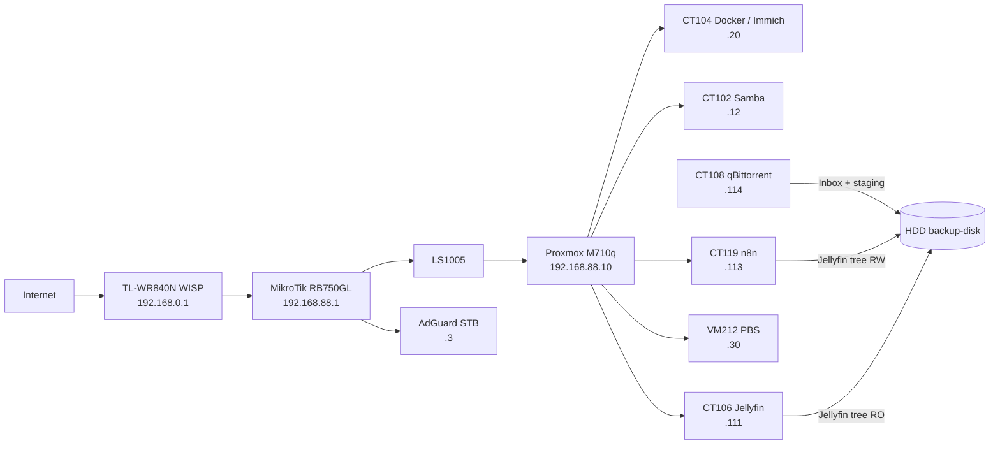

# Home Server Lab

> Audit live terakhir: **6 November 2026**. [Inventaris lengkap](docs/16-inventaris-live-2026-11-06.md).

Catatan sesi perencanaan 7 November: [arsitektur menyeluruh dan fase kerja](perencanaan-arsitektur/README.md). Ini rancangan, bukan audit live atau bukti implementasi.

Arsip ringkasan percakapan Claude tentang Homepage: [buka arsip percakapan](arsip-percakapan/claude-homepage-2026-11-07/README.md). Detail di dalamnya bersifat historis.

Repo ini mencatat rancangan, keadaan aktual, jaringan, endpoint layanan, backup, pekerjaan migrasi, dan rencana masa depan. Rencana dan catatan lama bukan bukti keadaan saat ini.

## Arsitektur ringkas

Alamat adalah alamat guest live saat audit. Sebagian lease DHCP dan belum diverifikasi tetap di MikroTik.

## Tautan layanan

| Layanan | Endpoint | Kondisi |
|---|---|---|
| Proxmox | https://192.168.88.10:8006 | 200 |
| PBS | https://192.168.88.30:8007 | 200 |
| Samba | Share Media, Immich, Files pada 192.168.88.12 | TCP 445 |
| Portainer | https://192.168.88.105:9443 | 200 |
| Immich / Beszel | http://192.168.88.20:2283 / :8090 | 200 |
| Jellyfin | http://192.168.88.111:8096 | API 200 |
| Nextcloud | http://192.168.88.112:8080 | status.php 200 |
| qBittorrent | http://192.168.88.114:8080 | 200; TCP/UDP 6881 |
| Uptime Kuma | http://192.168.88.106:3001 | login redirect |
| Prometheus | http://192.168.88.107:9090 | dibatasi firewall |
| Grafana | http://192.168.88.108:3000 | API 200 |
| Gotify | http://192.168.88.109:8070 | health 200 |
| Homepage | http://192.168.88.110:3000 | 200 |
| n8n | http://192.168.88.113:5678 | healthz 200 |
| Speedtest Tracker | http://192.168.88.115:8765 | login redirect; DHCP dinamis |
| Home Assistant | http://192.168.88.21/ ; Observer :4357 | 200 |

## Layanan terpasang

- PVE 9.2.24; Docker tidak terpasang di host.
- LXC aktif: CT101–112, CT115, CT119, CT121 (semua kecuali 113/114).
- VM aktif: VM202 Home Assistant OS dan VM212 PBS.
- CT100 dan VM200 template berhenti; VM201 Docker legacy berhenti.
- CT104 tetap menjalankan Immich, Beszel, Portainer lama, serta DB/Redis Nextcloud rollback.

## Plan pemasangan CT dan VM

Daftar lengkap per guest beserta tahap, dependensi, dan status rencananya ada di [Matriks rencana vs aktual — Daftar plan pemasangan guest](docs/13-matriks-rencana-aktual.md#daftar-plan-pemasangan-guest). Ringkasannya:

| Target usulan | Aplikasi | Status |
|---|---|---|
| CT113 | Beszel hub (pindah dari CT104) | Belum dibuat |
| CT114 | Caddy + CA lokal | Belum dibuat |
| CT116 / CT117 | Forgejo / Renovate | Belum dibuat |
| CT118 | AFFiNE | Belum dibuat |
| CT120 | WordPress | Belum dibuat |
| CT122 | OnlyOffice | Belum dibuat; opsional |
| VM203 / VM205 | k3s + Flux / Vaultwarden | Rencana lama |
| VM210 / VM213 | Situs statis publik / Pocket ID | Rencana lama |
| Belum ditetapkan | Navidrome | Target CT121 lama dibatalkan; CT121 kini Speedtest Tracker |

Urutan prioritas bukan berarti seluruh aplikasi pasti dipasang: selesaikan keamanan/backup CT121, otomasi media, lalu evaluasi migrasi Immich sebelum memilih guest berikutnya. Target IP belum dialokasikan. Lihat juga [STATUS](STATUS.md) dan [rencana isolasi guest](docs/14-usulan-isolasi-guest.md).

## Prioritas pekerjaan terbuka

1. CT121 .115 masih DHCP dinamis, belum ada onboot, belum masuk job PBS, dan Agent 9001 tanpa pembatasan sumber CT105. Belum diubah.
2. PBS disk 100 GiB berada pada NVMe yang sama dengan Proxmox; bukan backup fisik terpisah. Bind mount HDD bertanda backup=0 tidak tercakup backup guest.
3. PVE firewall global nonaktif; RouterOS DHCP, firewall/NAT, dan port forwarding tidak diverifikasi sesi ini.
4. Tinjau peringatan local-lvm thin-pool autoextend/overcommit.
5. Otomasi media n8n belum tuntas: cek paused state torrent, intake/kategori terpadu, isolasi tujuan non-Jellyfin, rename, dan uji e2e.
6. Rekonsiliasi aset Immich sebelum migrasi dan pertahankan rollback CT104.
7. Rencana layanan lainnya dicatat sebagai rencana, bukan kondisi terpasang, di [matriks](docs/13-matriks-rencana-aktual.md) dan [rencana guest](docs/14-usulan-isolasi-guest.md).

Bukti, MAC, resource, port, mount, koneksi, backup, dan ketidakpastian lengkap ada di [inventaris live](docs/16-inventaris-live-2026-11-06.md), [data guest](data/guest.yaml), dan [daftar port](docs/07-port-dan-akses.md).

## Label keadaan

- **Terverifikasi live:** diperiksa pada PVE/guest/LAN tanggal 6 Nov 2026.
- **Dilaporkan pengguna:** dikonfirmasi pengguna, tetapi bukan pemeriksaan RouterOS langsung.
- **Historis:** dari audit lama, belum dicek kembali.
- **Rencana/belum diketahui:** tidak teramati atau tidak bisa diverifikasi.

Jangan simpan password, token, private key, kunci enkripsi, atau nilai rahasia environment di repo.
