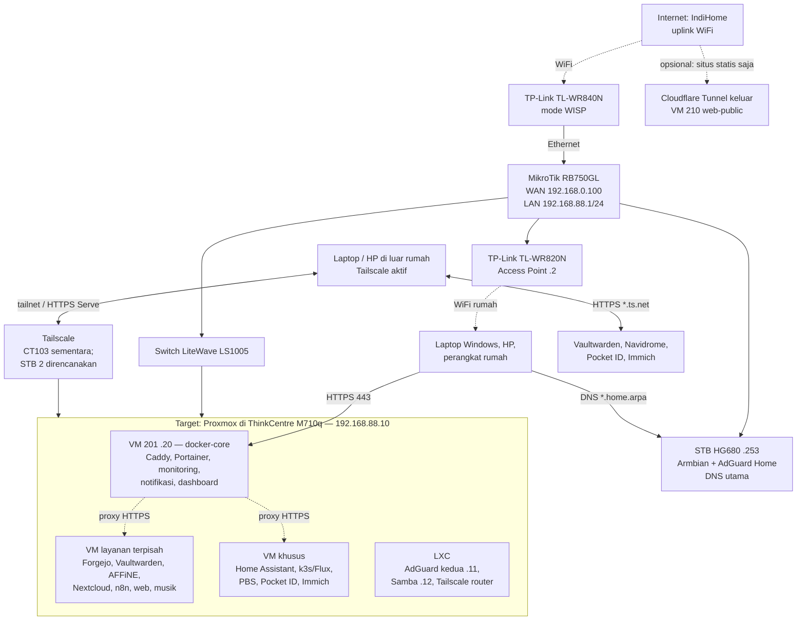

# Home Server Lab

Panduan dan catatan proyek home server pribadi berbasis **Lenovo ThinkCentre M710q**. Repo ini menggabungkan rancangan jaringan, panduan Proxmox, konfigurasi layanan, catatan pengujian, dan keputusan proyek dalam satu tempat.

> [!IMPORTANT]
> Repo ini **private dan tidak boleh berisi rahasia**. Jangan commit kata sandi, token, private key SSH/age, `ENCRYPTION_KEY`, kunci backup, dump database, atau arsip konfigurasi host. Nilai asli disimpan di Vaultwarden; repo hanya menyimpan contoh seperti `*.example`.

## Status proyek

Jaringan rumah terakhir diverifikasi **28 Oktober 2026**. Proxmox dipasang dan diperbarui pada **31 Oktober 2026**; per 1 November host masih memakai alamat sementara `192.168.0.200` dan sedang disiapkan untuk pindah ke MikroTik. Rincian ada di [STATUS.md](STATUS.md).

- **Jaringan rumah sudah berjalan:** IndiHome melalui WiFi ke TL-WR840N mode WISP, lalu ke MikroTik RB750GL. Access point dan STB AdGuard juga sudah berfungsi.
- **Server utama:** ThinkCentre M710q, Intel Core i5-6500T (4 core/4 thread), Proxmox sudah berjalan. RAM terpasang 16+8 GB; Linux melaporkan 23 GiB, tetapi BIOS/MemTest86 belum diperiksa. NVMe Samsung terdeteksi sebagai `nvme0n1`, 476,9 GB. Kernel aktif `7.0.14-26-pve`; tidak ada unit systemd gagal.
- **Penyimpanan:** dua HDD Seagate Surveillance 2 TB berukuran 3,5 inci belum disambungkan. Enclosure single-bay lama ditemukan, belum diuji, dan berada di rumah bersama HDD.
- **Langkah server:** Proxmox VE 9.2.24 sudah diperbarui; kernel `7.0.14-26-pve`; `local` dan `local-lvm` aktif. VT-x/KVM lulus pemeriksaan setelah perbaikan lewat `thinklmi`. Template Debian 13 VM 200 dan CT 100 diverifikasi lewat SSH. Nama yang tercatat pada host adalah `Tamplate-VM` dan `Tamplate-CT` (kemungkinan typo). VM 200: 1 vCPU, RAM 2 GiB, disk 32 GiB, QEMU Agent aktif di konfigurasi; paket di guest belum diperiksa. CT 100: 1 vCPU, RAM/swap 512 MiB, disk 8 GiB, unprivileged, nesting, DHCP. Guest layanan, backup, dan pemulihan belum dibuat atau diuji.
- Buku panduan lengkap Bab 1–56, lampiran, fase, dan roadmap tersedia dalam edisi terpadu. Status template dan rencana jaringan diperbarui; guest layanan, backup, dan pemulihan **belum diuji**. Sumber buku ada di [panduan-lengkap-home-server-lab.md](docs/panduan-lengkap-home-server-lab.md); build PDF ada di [tools/book_builder/README.md](tools/book_builder/README.md) dan [tools/build_handbook.py](tools/build_handbook.py). Riwayat pengujian ada di [catatan/hasil-uji.md](catatan/hasil-uji.md).
- Tailscale subnet router khusus masih menunggu STB 2; sementara rancangan memakai CT103 di Proxmox.

Repo pernah memuat rencana lab VMware. Rencana tersebut sudah dihentikan dan dihapus dari alur instalasi pada Revisi 3. Lihat [catatan Revisi 3](docs/bab/REVISI-3.md).

## Gambaran jaringan

Diagram berikut menggabungkan jaringan rumah yang sudah berjalan dengan server dan layanan yang **masih menjadi target**, bukan klaim bahwa semuanya sudah dipasang.

### Cara membaca diagram

- **Jaringan rumah:** MikroTik menjadi gateway, DHCP, firewall, dan NAT. Pool DHCP direncanakan pada `192.168.88.100–254`; alamat server menggunakan rentang statis di luar pool.
- **DNS:** AdGuard Home utama berada di STB HG680 `192.168.88.253`. AdGuard kedua di CT101 `.11` direncanakan sebagai cadangan. Nama `*.home.arpa` diarahkan ke Caddy di VM 201.
- **Akses privat lokal:** klien membuka layanan melalui Caddy pada HTTPS 443; firewall Proxmox membatasi port aplikasi agar hanya dapat dijangkau dari gerbang yang diperlukan.
- **Akses dari luar rumah:** memakai Tailscale. Rancangan tidak membuka port admin Proxmox atau router ke internet dan tidak memakai Tailscale Funnel.
- **Situs publik opsional:** hanya situs statis di VM 210 melalui koneksi keluar Cloudflare Tunnel; VM ini dirancang terisolasi dari LAN.
- Detail kabel, DNS, akses jauh, GitOps, monitoring, dan backup ada di [diagram alur koneksi](docs/02-rangkaian-koneksi.md).

## Arsitektur layanan target

Host Proxmox dibuat sesederhana mungkin: **tanpa Docker dan tanpa aplikasi**. Layanan yang memakai Docker ditempatkan di VM Debian; layanan Linux ringan tanpa Docker dapat memakai LXC. Pemisahan ini membantu membatasi dampak gangguan, mengatur akses jaringan, dan memulihkan layanan satu per satu.

| Guest | Alamat | Peran target |
|---|---:|---|
| Host Proxmox | `192.168.88.10` | Hypervisor M710q |
| CT101 / CT102 | `.11 / .12` | AdGuard kedua / Samba |
| CT103 | Belum ditetapkan | Tailscale subnet router sementara |
| VM 201 | `.20` | Caddy, Portainer, Gotify, Uptime Kuma, Beszel, Homepage |
| VM 202 / 203 | `.21 / .22` | Home Assistant OS / k3s + Flux |
| VM 204 / 205 | `.23 / .24` | Forgejo + Renovate / Vaultwarden |
| VM 206 / 207 | `.25 / .26` | AFFiNE / Nextcloud |
| VM 208 / 209 | `.27 / .28` | n8n / situs privat + WordPress |
| VM 210 | `.29` | Situs statis publik opsional; akses melalui tunnel keluar |
| VM 212 / 211 | `.30 / .31` | Proxmox Backup Server / Navidrome |
| VM 213 / 214 | `.32 / .33` | Pocket ID / Immich |
| VM 200 | — | `Tamplate-VM` (kemungkinan typo); Debian 13, template, 1 vCPU/2 GiB/32 GiB. Paket guest belum diperiksa |
| CT 100 | — | `Tamplate-CT` (kemungkinan typo); Debian 13, unprivileged, 1 vCPU, RAM/swap 512 MiB, disk 8 GiB, DHCP |

Peta guest layanan ini adalah **rancangan**; template sudah dibuat tetapi guest layanan belum. Daftar terstruktur beserta RAM dan catatan mode hemat ada di [data/guest.yaml](data/guest.yaml). Tabel port dan aturan akses ada di [docs/07-port-dan-akses.md](docs/07-port-dan-akses.md).

Linux melaporkan 23 GiB dari konfigurasi RAM 16+8 GB. BIOS/MemTest86 belum diperiksa; gunakan profil konservatif dan pantau penggunaan sebelum menyalakan banyak VM. Mode hemat tetap perlu memantau batas CPU 4 thread.

## Penyimpanan dan backup

Rancangan penyimpanan memakai NVMe 500 GB untuk sistem/VM. Rencana sementara adalah menguji satu HDD 3,5 inci melalui enclosure single-bay lama yang ditemukan; enclosure belum diuji dan HDD kedua ditunda. Peran storage (termasuk datastore PBS) belum diputuskan. PBS direncanakan mencadangkan VM setiap hari, dengan enkripsi sisi klien, salinan USB offline, dan arsip konfigurasi host.

**Keadaan saat ini:** kedua HDD belum tersambung; enclosure belum diuji; PBS belum dipasang; belum ada backup atau uji pemulihan. Karena itu backup belum boleh dianggap tersedia. Prosedur backup baru dianggap terbukti setelah pemulihan berhasil diuji. Lihat [Bab 50](docs/bab/suplemen/50-proxmox-backup-server.md) dan catatan uji.

## Mulai menjelajahi repo

Buku utama terbaru: [Panduan Lengkap Home Server Lab - Edisi Lengkap 2026](docs/panduan-lengkap-home-server-lab.md). PDF edisi terpadu 2026.11 berisi 258 halaman. Sumber Markdown ada di repo; PDF hasil build disimpan lokal pada `06-Book`. Build dapat diulang lewat [tools/book_builder/README.md](tools/book_builder/README.md).

1. Baca [tujuan awal](docs/00-ide-awal.md) dan [arsitektur target](docs/01-ide-akhir.md).
2. Lihat [status dan langkah berikutnya](STATUS.md), lalu [urutan hari pertama di M710q](docs/09-mulai-di-m710q.md).
3. Gunakan [board proyek](docs/04-board.md) untuk melihat fase dan backlog.
4. Baca [Edisi 2: Bab 1–24](docs/bab/edisi2/README.md) dan [Suplemen: Bab 25–56](docs/bab/suplemen/README.md).
5. Cek [butir yang belum pasti](catatan/belum-pasti.md) dan [hasil uji](catatan/hasil-uji.md).

### Peta dokumentasi

| Lokasi | Isi |
|---|---|
| `docs/00-ide-awal.md` – `docs/10-konteks-proyek.md` | Tujuan, arsitektur, diagram jaringan, perangkat, konsep, port, keputusan, status awal, dan preferensi kerja |
| `docs/11-rencana-kerja-ai-ssh.md` | Koordinasi Codex dan Claude saat mengakses Proxmox lewat SSH |
| [docs/12-roadmap-manfaat-keamanan.md](docs/12-roadmap-manfaat-keamanan.md) | Prioritas peningkatan kegunaan, keamanan, backup, pemantauan, dan segmentasi jaringan |
| [docs/panduan-lengkap-home-server-lab.md](docs/panduan-lengkap-home-server-lab.md) | Sumber buku pemula terpadu, langkah kerja, diagram, checklist, perintah, serta syarat lulus tiap fase |
| `docs/bab/edisi2/` | Instalasi Proxmox, jaringan, VM/LXC, Docker, Git, Home Assistant, dan dasar layanan |
| `docs/bab/suplemen/` | Keamanan, Tailscale, M710q, monitoring, Caddy, web, aplikasi, penempatan, PBS, firewall, audit, foto, dan profil RAM |
| `konfigurasi/` | Contoh konfigurasi server, GitOps, Caddy, firewall, skrip, dan contoh environment |
| `data/` | Data terstruktur perangkat dan guest |
| `catatan/` | Hasil uji, hal belum pasti, dan pelajaran dari lab terdahulu |
| `docs/arsip/` | Materi lama sebelum Revisi 3 untuk riwayat |

> [!WARNING]
> Teks bab hasil ekstraksi dan arsip dapat kehilangan indentasi YAML. Untuk Compose dan YAML, gunakan berkas di `konfigurasi/` sebagai sumber format yang benar. Konfigurasi tersebut belum dijalankan di server.

## Aturan kerja dan keamanan

- Jawab dan tulis panduan dalam **Bahasa Indonesia**; pengguna belajar dari dasar dan menggunakan Windows serta Android. Panduan klien juga mencakup iPhone bila relevan.
- Berikan satu langkah per giliran untuk sesi pengujian; tunggu hasil dan catat pesan error persis sebelum lanjut.
- Gunakan IP, VMID, dan RAM dari `data/guest.yaml`; jangan menebak bila data berbeda atau belum diperiksa.
- Perintah panduan memakai alur tanpa `sudo` (akun biasa lalu `su -`, atau root di host Proxmox).
- Tandai asumsi yang belum diverifikasi dengan **[BELUM PASTI]**. Periksa dokumentasi resmi saat menulis instruksi teknis baru.
- Sebelum perubahan berisiko—misalnya disk, firewall, jaringan, SSH, atau penghapusan VM—jelaskan dampak dan jalur pemulihan.
- Untuk akses melalui SSH oleh lebih dari satu asisten, hanya satu operator yang boleh mengubah server pada satu waktu. Lakukan audit baca-saja dahulu dan tulis catatan serah-terima. Lihat [rencana kerja AI melalui SSH](docs/11-rencana-kerja-ai-ssh.md).
- Jangan menaruh rahasia di chat maupun repo; gunakan Vaultwarden untuk nilai asli.

## Riwayat revisi

- **Revisi 3 (28 Oktober 2026):** menghapus rencana lab VMware dan instal-ke-disk-dulu setelah M710q tersedia. Mesin asli menjadi target instal Proxmox langsung dari USB.
- **Revisi 4 (30 Oktober 2026):** memperbaiki kebijakan akses Tailscale, direktori penyimpanan PostgreSQL 18 pada n8n, dan nilai awal pendaftaran Vaultwarden. Lihat [catatan Revisi 4](docs/bab/REVISI-4.md).
- **Revisi 6 (1 November 2026):** mencatat template yang sudah dibuat (VM 200 dan CT 100), status Proxmox VE 9.2.24, dan penyesuaian jaringan rumah yang masih menunggu perpindahan host ke MikroTik.
