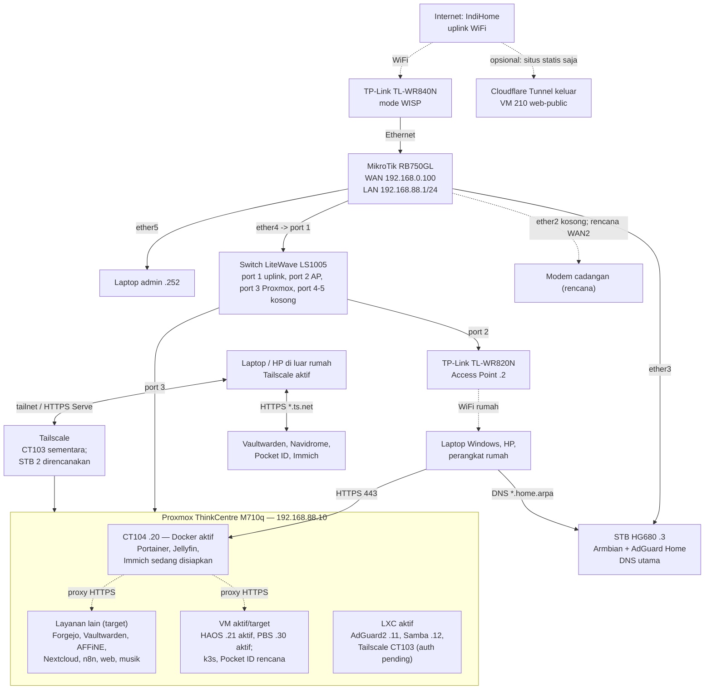

# Home Server Lab

Panduan dan catatan proyek home server pribadi berbasis **Lenovo ThinkCentre M710q**. Repo ini menggabungkan rancangan jaringan, panduan Proxmox, konfigurasi layanan, catatan pengujian, dan keputusan proyek dalam satu tempat.

> [!IMPORTANT]
> Repo ini **private dan tidak boleh berisi rahasia**. Jangan commit kata sandi, token, private key SSH/age, `ENCRYPTION_KEY`, kunci backup, dump database, atau arsip konfigurasi host. Nilai asli disimpan di Vaultwarden; repo hanya menyimpan contoh seperti `*.example`.

## Status proyek

Pembaruan terakhir **3 November 2026**: Proxmox `.10` terhubung internet; CT101 AdGuard `.11` aktif dan tes DNS A/AAAA dari host/laptop lulus; DHCP membagikan `.3` dan `.11`, failover belum diuji. CT102 Samba `.12` aktif dengan share Media/Files, menunggu password SMB dari pengguna. CT104 Docker `.20` statis menjalankan Portainer 2.45.3 dan Jellyfin sehat; image Immich sedang diunduh, belum siap sampai health/UI diverifikasi. CT103 Tailscale subnet router memperoleh lease sementara `.104`, sudah mengiklankan LAN tetapi perlu login dan approval route pengguna. VM202 Home Assistant OS `.21` berjalan dan onboarding selesai menurut pengguna. PBS 212 `.30` merespons ping dan web `:8007`; autostart aktif, disk 100 GiB NVMe terpasang, datastore `store1` dilaporkan dibuat namun belum diverifikasi, belum ada backup. HDD unit 1 digunakan untuk data aplikasi; volume qcow lama PBS dilepas dari VM namun tetap disimpan. Lihat [STATUS.md](STATUS.md) untuk rincian dan batas verifikasi.

- **Jaringan rumah sudah berjalan:** IndiHome melalui WiFi ke TL-WR840N mode WISP, lalu ke MikroTik RB750GL. Access point dan STB AdGuard juga sudah berfungsi.
- **Server utama:** ThinkCentre M710q, Intel Core i5-6500T (4 core/4 thread), Proxmox sudah berjalan. RAM terpasang 16+8 GB; Linux melaporkan 23 GiB, tetapi BIOS/MemTest86 belum diperiksa. NVMe Samsung terdeteksi sebagai `nvme0n1`, 476,9 GB. Kernel aktif `7.0.14-26-pve`; tidak ada unit systemd gagal.
- **Penyimpanan:** HDD Seagate 2 TB terhubung, identitas dan isi diperiksa read-only; partisi NTFS sebelumnya hanya menampilkan `System Volume Information` di root, 159 MB terpakai. SMART attributes overall PASSED (USB bridge tidak memberikan status registers lengkap), suhu 31°C, nol sektor reallocated/pending. Disk diubah menjadi GPT/ext4 dan storage Proxmox `backup-disk` aktif. Volume virtual 1.5 TiB pada HDD sudah dilepas dari PBS tanpa menghapus file volume. Disk virtual 100 GiB di NVMe/local-lvm terpasang; pengguna melaporkan datastore `store1` dibuat (dashboard belum diverifikasi), belum ada backup. Kedua HDD direncanakan untuk data aplikasi; HDD kedua menunggu enclosure.
- **Layanan terpasang:** CT101 `adguard2` statis `.11`, onboot aktif dan AdGuard Home aktif; kueri DNS A/AAAA host/laptop lulus. DHCP membagikan `.3` + `.11`; failover belum diuji. CT102 Samba `.12` aktif dengan share `Media`/`Files` ke HDD; akun `labshare` menunggu password SMB dan tes klien Windows. CT103 Tailscale 1.104.4 terpasang, IP sementara DHCP `.104`, forwarding dan TUN aktif; menunggu login serta approval route LAN. CT104 `docker-services` aktif di `.20/24` statis pada konfigurasi Proxmox, di luar pool DHCP; Portainer HTTPS 9443 dan Jellyfin sehat pada 8096. HDD ter-mount sebagai `/srv/media` dan `/srv/appdata` (sekitar 1.7 TiB bebas); Immich image masih diunduh, sehingga belum dinyatakan siap. VM201 `docker-core` berhenti/onboot=0. VM202 HAOS 18.4 aktif di `.21`, UEFI, 2 vCPU/2 GiB, disk 32 GiB; checksum image resmi cocok dan onboarding selesai menurut pengguna.
- Buku panduan lengkap Bab 1–56, lampiran, fase, dan roadmap tersedia dalam edisi terpadu. Revisi 7 mencatat audit identitas template dan hasil clone; guest layanan, backup, dan pemulihan **belum diuji**. Sumber buku ada di [panduan-lengkap-home-server-lab.md](docs/panduan-lengkap-home-server-lab.md); build PDF ada di [tools/book_builder/README.md](tools/book_builder/README.md) dan [tools/build_handbook.py](tools/build_handbook.py). Riwayat pengujian ada di [catatan/hasil-uji.md](catatan/hasil-uji.md).
- Tailscale sudah dipasang pada CT103 dan menunggu login serta persetujuan subnet route oleh pengguna. Pemindahan ke STB2 tetap rencana setelah perangkat tersedia.

Repo pernah memuat rencana lab VMware. Rencana tersebut sudah dihentikan dan dihapus dari alur instalasi pada Revisi 3. Lihat [catatan Revisi 3](docs/bab/REVISI-3.md).

## Gambaran jaringan

Diagram berikut menggabungkan jaringan rumah yang sudah berjalan dengan server dan layanan yang **masih menjadi target**, bukan klaim bahwa semuanya sudah dipasang.

### Cara membaca diagram

- **Jaringan rumah:** MikroTik menjadi gateway, DHCP, firewall, dan NAT. Pool DHCP direncanakan pada `192.168.88.100–254`; alamat server menggunakan rentang statis di luar pool.
- **DNS:** AdGuard Home utama berada di STB HG680 `192.168.88.3`; CT101 `.11` juga aktif. DHCP MikroTik membagikan `.3` dan `.11`, laptop menerima keduanya; kueri langsung A/AAAA ke dua resolver berhasil, tetapi failover belum diuji. Nama `*.home.arpa` ke Caddy masih target.
- **Akses privat lokal:** Caddy HTTPS 443 masih target. Saat ini Portainer, Jellyfin, dan layanan lain yang aktif dibuka memakai port masing-masing pada LAN.
- **Akses dari luar rumah:** memakai Tailscale. Rancangan tidak membuka port admin Proxmox atau router ke internet dan tidak memakai Tailscale Funnel.
- **Situs publik opsional:** hanya situs statis di VM 210 melalui koneksi keluar Cloudflare Tunnel; VM ini dirancang terisolasi dari LAN.
- Detail kabel, DNS, akses jauh, GitOps, monitoring, dan backup ada di [diagram alur koneksi](docs/02-rangkaian-koneksi.md).

## Arsitektur layanan target

Host Proxmox dibuat sesederhana mungkin: **tanpa Docker dan tanpa aplikasi**. Sesuai keputusan proyek, Docker ditempatkan di CT104 Debian 13 unprivileged dengan nesting; ini menghemat VM namun isolasinya lebih rendah daripada Docker di VM. Aplikasi yang memang memerlukan OS terpisah memakai VM.

| Guest | Alamat | Peran target |
|---|---:|---|
| Host Proxmox | `192.168.88.10` | Hypervisor M710q |
| CT101 / CT102 | `.11 / .12` | AdGuard kedua aktif / Samba aktif, password share menunggu pengguna |
| CT103 | `.104` lease sementara; IP final belum ditetapkan | Tailscale subnet router terpasang; login dan approval `192.168.88.0/24` menunggu pengguna |
| CT104 | `.20` statis di konfigurasi CT, ping lulus; tanpa reservasi router (di luar pool DHCP) | Docker/Portainer + Jellyfin; Immich sedang diunduh; HDD `/srv/media` dan `/srv/appdata` |
| VM 201 | Tidak ada IP; stopped | docker-core tidak digunakan; target `.20` dialihkan ke CT104 |
| VM 202 / 203 | `.21` aktif / `.22` target | Home Assistant OS (running, onboarding selesai menurut pengguna) / k3s + Flux (rencana) |
| VM 204 / 205 | `.23 / .24` | Forgejo + Renovate / Vaultwarden |
| VM 206 / 207 | `.25 / .26` | AFFiNE / Nextcloud |
| VM 208 / 209 | `.27 / .28` | n8n / situs privat + WordPress |
| VM 210 | `.29` | Situs statis publik opsional; akses melalui tunnel keluar |
| VM 212 / 211 | `.30` aktif / `.31` target | PBS 4.2; disk 100 GiB NVMe, `store1` dilaporkan dibuat; disk HDD 1.5 TiB dilepas dari VM / Navidrome rencana |
| VM 213 / 214 | `.32 / .33` | Pocket ID / Immich |
| VM 200 | — | Template Debian 13 bersih; 1 vCPU/2 GiB/32 GiB, QEMU Agent aktif pada konfigurasi |
| CT 100 | — | Template Debian 13 bersih; 1 vCPU/512 MiB RAM dan swap/8 GiB, unprivileged, nesting, DHCP |

Rancangan layanan tetap bertahap. Layanan yang sudah berjalan dan status IP aktual dibedakan dari target di [data/guest.yaml](data/guest.yaml); failover DNS, verifikasi datastore PBS, backup, password Samba, otorisasi Tailscale, health check Immich, Grafana/datasource, dan pemindahan data aplikasi berikutnya masih perlu diselesaikan. Tabel port dan aturan akses ada di [docs/07-port-dan-akses.md](docs/07-port-dan-akses.md).

Linux melaporkan 23 GiB dari konfigurasi RAM 16+8 GB. BIOS/MemTest86 belum diperiksa; gunakan profil konservatif dan pantau penggunaan sebelum menyalakan banyak VM. Mode hemat tetap perlu memantau batas CPU 4 thread.

## Penyimpanan dan backup

Rencana terbaru pengguna: kedua HDD 2 TB untuk data aplikasi (Nextcloud, Immich, Jellyfin, dll.); backup sementara di NVMe. HDD unit 1 GPT/ext4 tersedia di Proxmox; volume virtual PBS 1.5 TiB sudah dilepas dari VM tanpa dihapus. Disk 100 GiB terpasang ke PBS dan `store1` dilaporkan dibuat; verifikasi dashboard/backup belum dilakukan.

**Keadaan saat ini:** PBS 212 sudah terpasang menurut pengguna; setelah hard reset, `.30` membalas ping 3/3 dan HTTPS `:8007` HTTP 200. Disk 1.5 TiB pada HDD dilepas dari VM tanpa menghapus volumenya; volume tetap tersimpan di storage HDD. Disk virtual 100 GiB pada NVMe/local-lvm terpasang; pengguna melaporkan datastore `store1` dibuat, tetapi dashboard belum diverifikasi. Belum ada backup atau uji restore. CT104 `.20` dan CT102 `.12` berjalan; HDD ter-mount ke CT104 `/srv/media` dan `/srv/appdata`, serta ke CT102 `/srv/media` dan `/srv/files`. Lihat [Bab 50](docs/bab/suplemen/50-proxmox-backup-server.md) dan catatan uji.

## Mulai menjelajahi repo

Buku utama terbaru: [Panduan Lengkap Home Server Lab - Edisi Lengkap 2026](docs/panduan-lengkap-home-server-lab.md). PDF edisi terpadu 2026.11 berisi 258 halaman. Sumber Markdown ada di repo; PDF hasil build disimpan lokal pada `06-Book`. Build dapat diulang lewat [tools/book_builder/README.md](tools/book_builder/README.md).

1. Baca [tujuan awal](docs/00-ide-awal.md) dan [arsitektur target](docs/01-ide-akhir.md).
2. Lihat [status dan langkah berikutnya](STATUS.md), lalu [urutan hari pertama di M710q](docs/09-mulai-di-m710q.md).
3. Gunakan [board proyek](docs/04-board.md) untuk melihat fase dan backlog.
4. Baca [Edisi 2: Bab 1–24](docs/bab/edisi2/README.md) dan [Suplemen: Bab 25–56](docs/bab/suplemen/README.md).
5. Cek [butir yang belum pasti](catatan/belum-pasti.md) dan [hasil uji](catatan/hasil-uji.md).

### Peta dokumentasi

| Lokasi | Isi |
|---|---|
| `docs/00-ide-awal.md` – `docs/10-konteks-proyek.md` | Tujuan, arsitektur, diagram jaringan, perangkat, konsep, port, keputusan, status awal, dan preferensi kerja |
| `docs/11-rencana-kerja-ai-ssh.md` | Koordinasi Codex dan Claude saat mengakses Proxmox lewat SSH |
| [docs/12-roadmap-manfaat-keamanan.md](docs/12-roadmap-manfaat-keamanan.md) | Prioritas peningkatan kegunaan, keamanan, backup, pemantauan, dan segmentasi jaringan |
| [docs/panduan-lengkap-home-server-lab.md](docs/panduan-lengkap-home-server-lab.md) | Sumber buku pemula terpadu, langkah kerja, diagram, checklist, perintah, serta syarat lulus tiap fase |
| `docs/bab/edisi2/` | Instalasi Proxmox, jaringan, VM/LXC, Docker, Git, Home Assistant, dan dasar layanan |
| `docs/bab/suplemen/` | Keamanan, Tailscale, M710q, monitoring, Caddy, web, aplikasi, penempatan, PBS, firewall, audit, foto, dan profil RAM |
| `konfigurasi/` | Contoh konfigurasi server, GitOps, Caddy, firewall, skrip, dan contoh environment |
| `data/` | Data terstruktur perangkat dan guest |
| `catatan/` | Hasil uji, hal belum pasti, dan pelajaran dari lab terdahulu |
| `docs/arsip/` | Materi lama sebelum Revisi 3 untuk riwayat |

> [!WARNING]
> Teks bab hasil ekstraksi dan arsip dapat kehilangan indentasi YAML. Untuk Compose dan YAML, gunakan berkas di `konfigurasi/` sebagai sumber format yang benar. Konfigurasi tersebut belum dijalankan di server.

## Aturan kerja dan keamanan

- Jawab dan tulis panduan dalam **Bahasa Indonesia**; pengguna belajar dari dasar dan menggunakan Windows serta Android. Panduan klien juga mencakup iPhone bila relevan.
- Berikan satu langkah per giliran untuk sesi pengujian; tunggu hasil dan catat pesan error persis sebelum lanjut.
- Gunakan IP, VMID, dan RAM dari `data/guest.yaml`; jangan menebak bila data berbeda atau belum diperiksa.
- Perintah panduan memakai alur tanpa `sudo` (akun biasa lalu `su -`, atau root di host Proxmox).
- Tandai asumsi yang belum diverifikasi dengan **[BELUM PASTI]**. Periksa dokumentasi resmi saat menulis instruksi teknis baru.
- Sebelum perubahan berisiko—misalnya disk, firewall, jaringan, SSH, atau penghapusan VM—jelaskan dampak dan jalur pemulihan.
- Untuk akses melalui SSH oleh lebih dari satu asisten, hanya satu operator yang boleh mengubah server pada satu waktu. Lakukan audit baca-saja dahulu dan tulis catatan serah-terima. Lihat [rencana kerja AI melalui SSH](docs/11-rencana-kerja-ai-ssh.md).
- Jangan menaruh rahasia di chat maupun repo; gunakan Vaultwarden untuk nilai asli.

## Riwayat revisi

- **Revisi 3 (28 Oktober 2026):** menghapus rencana lab VMware dan instal-ke-disk-dulu setelah M710q tersedia. Mesin asli menjadi target instal Proxmox langsung dari USB.
- **Revisi 4 (30 Oktober 2026):** memperbaiki kebijakan akses Tailscale, direktori penyimpanan PostgreSQL 18 pada n8n, dan nilai awal pendaftaran Vaultwarden. Lihat [catatan Revisi 4](docs/bab/REVISI-4.md).
- **Revisi 6 (1 November 2026):** mencatat template Debian 13 VM/CT dan persiapan jaringan MikroTik.
- **Revisi 7 (1 November 2026):** mencatat identitas yang ikut tersalin, perbaikan template CT 100/VM 200, hasil clone, dan pembersihan guest uji.
- **Revisi 8 (1 November 2026):** membuat CT 101 `adguard2` dan VM 201 `docker-core` dari template. Keduanya berjalan dengan DHCP router sementara; IP akhir dan pemasangan aplikasi menunggu MikroTik. Lihat [catatan Revisi 8](docs/bab/REVISI-8.md).
- **Revisi 9 (1 November 2026):** memasang AdGuard Home pada CT101 (service ditahan sampai jaringan final) dan Docker CE/Compose pada VM201. Lihat [catatan Revisi 9](docs/bab/REVISI-9.md).
- **Revisi 10 (1 November 2026):** menangani pesan `systemd-ssh-generator` AF_VSOCK pada VM201; SSH TCP dan Docker tetap aktif. Lihat [catatan Revisi 10](docs/bab/REVISI-10.md).
