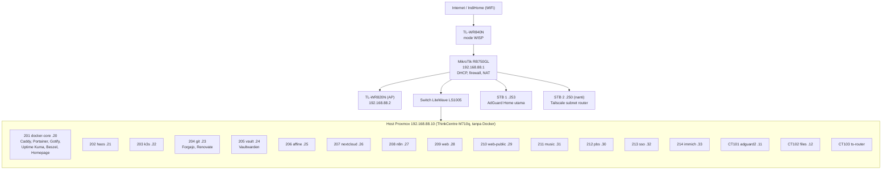

# 01 - Ide akhir (target arsitektur)

Gambaran setelah seluruh buku (Edisi 2 + Suplemen 1-9) dikerjakan dan lulus uji.

## Ringkasan dalam satu kalimat
Satu host Proxmox polos (tanpa Docker) berisi VM/LXC terpisah per layanan; satu gerbang HTTPS (Caddy)
untuk layanan privat; layanan paling sensitif hanya lewat Tailscale Serve; backup harian ke PBS di
disk terpisah dengan salinan kedua; firewall Proxmox antar-guest; akses luar hanya Tailscale.

## Diagram target

## Aturan penempatan (Bab 48.2)
| Pertanyaan | Jika ya |
|---|---|
| Memakai Docker? | VM (bukan LXC) |
| Layanan Linux ringan tanpa Docker? | Boleh LXC |
| Menyimpan rahasia? | VM sendiri |
| Menghadap internet? | VM sendiri, paling terisolasi |
| Data besar / siklus update berbeda? | VM sendiri |
| Ringan dan saling bergantung? | Gabung di docker-core |

## Tiga jalur akses
| Jalur | Dipakai oleh | Sertifikat |
|---|---|---|
| A. Caddy `*.home.arpa` | web, WordPress, n8n, AFFiNE, Nextcloud, Forgejo, Kuma, Beszel, Gotify | CA lokal Caddy (akar dipasang di perangkat) |
| B. Tailscale Serve `*.ts.net` | Vaultwarden, Navidrome, Pocket ID, Immich | Sertifikat tepercaya (tanpa domain) |
| C. Cloudflare Tunnel (opsional) | Hanya situs statis publik (VM 210) | Sertifikat Cloudflare |

## Pertahanan berlapis (Bab 25.1)
1. Internet: tidak ada port dibuka dari rumah.
2. WISP + IndiHome: NAT berlapis, tanpa port forwarding.
3. MikroTik: firewall input dan forward, layanan admin dibatasi LAN.
4. Tailscale: satu-satunya jalan masuk dari luar, dengan kebijakan akses.
5. Proxmox dan VM: firewall antar-guest, akun admin terpisah, 2FA, SSH hanya kunci.
6. Aplikasi dan data: update otomatis, backup 3-2-1, uji pemulihan.

## Backup (Bab 50)
- PBS di VM 212, datastore di disk fisik terpisah, enkripsi sisi klien (kunci wajib disimpan di dua tempat).
- Job harian 02:00 (snapshot), prune/GC/verify di PBS.
- Salinan kedua di luar mesin (USB offline), arsip konfigurasi host (`/etc/pve`).
- **Belum dianggap ada sebelum satu uji pulih berhasil.**

## Mesin: Lenovo ThinkCentre M710q (Bab 27 dan 56)
Core i5-6500T (4 core/4 thread). SSD NVMe M.2 500 GB sudah dipasang di slot 1. RAM yang dilaporkan terpasang adalah **24 GB (1×16 + 1×8)**; jumlah BIOS/OS dan MemTest86 belum diverifikasi. Proxmox belum dipasang. HDD 2 TB direncanakan untuk data/backup.
- Dengan 16 GB: lima profil pemakaian (harian, kerja, foto, backup, belajar) memakai `konfigurasi/skrip/profil.sh`.
- Profil lama dibuat untuk 16 GB dan 32 GB. Dengan RAM yang diperkirakan 24 GB, mulai dari profil konservatif Bab 56 dan naikkan bertahap setelah pemantauan; CPU 4 thread tetap menjadi batas penting.

## Yang belum masuk target
Suplemen 10-11: AMP + playit.gg, Ollama, OnlyOffice, TrueNAS, STB 2, update profil RAM saat RAM naik.
Lihat `04-board.md`.

