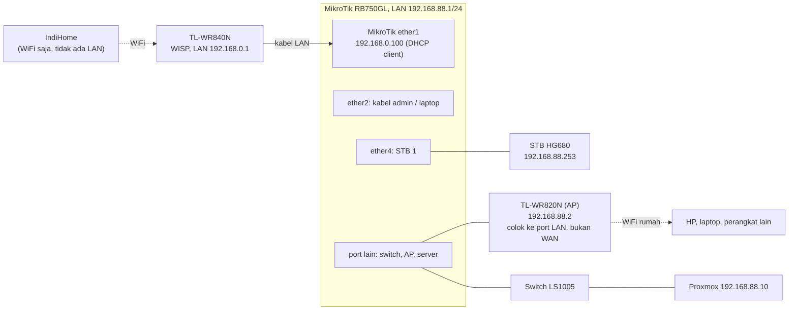
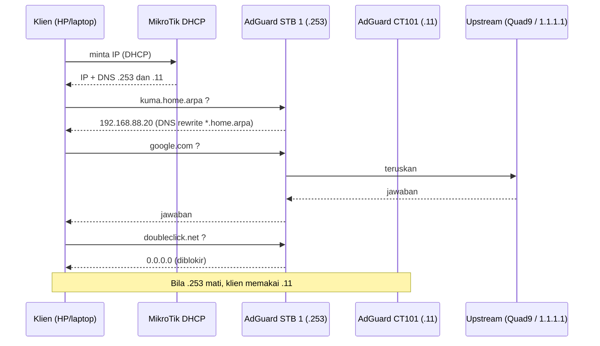
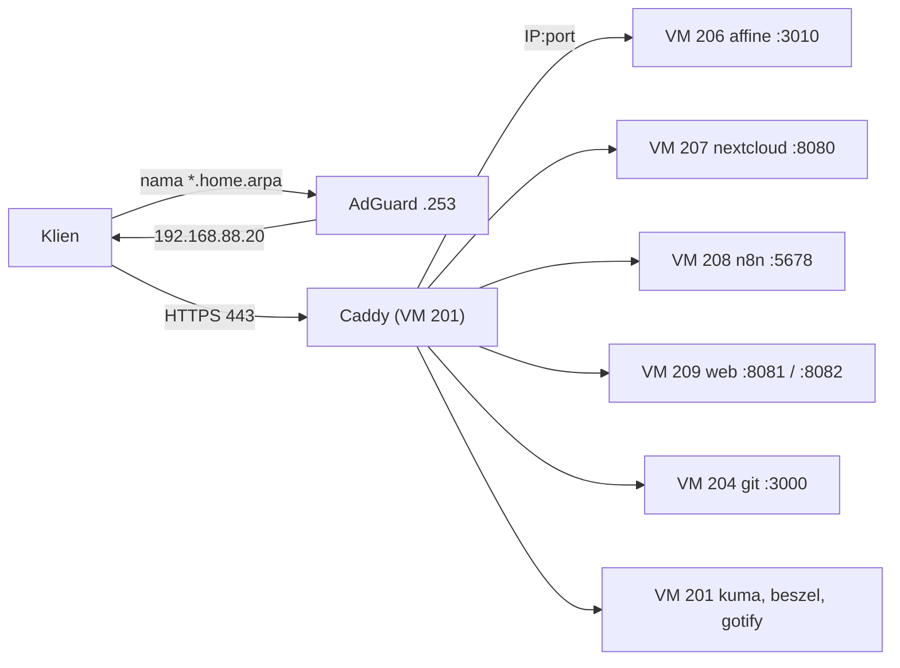
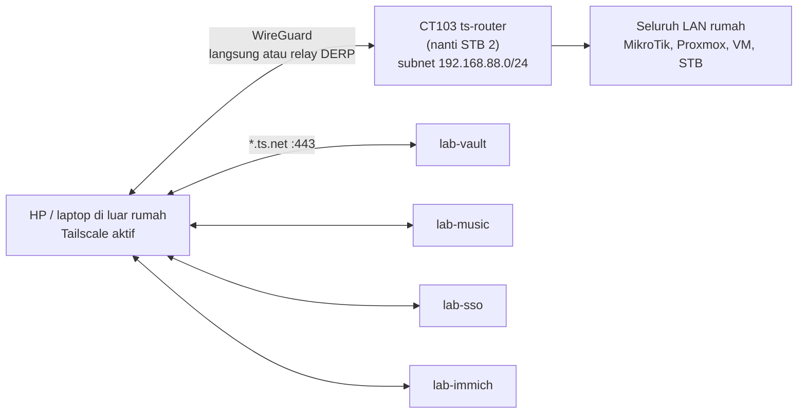
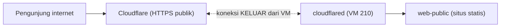
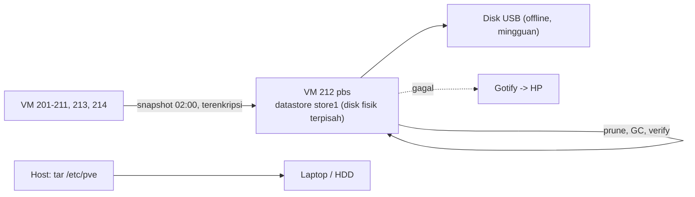
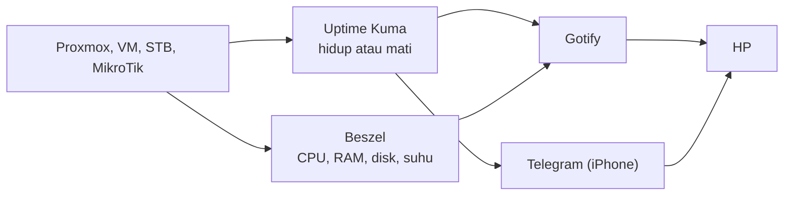
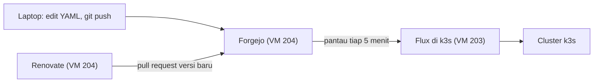

# 02 - Rangkaian koneksi

Dari kabel fisik sampai alur data. Diagram memakai Mermaid (tampil otomatis di GitHub).

## 1. Rangkaian fisik (kabel dan radio)

Catatan kabel:
- AP dicolok ke port **LAN** AP (bukan WAN/Internet), DHCP AP dimatikan.
- Saat setup MikroTik, laptop di **ether2** (bukan ether1 yang ke WAN).
- Laptop admin: kabel via adaptor USB-LAN ke jaringan MikroTik (`192.168.88.252`). Server Proxmox: kabel LAN dari port Ethernet M710q ke MikroTik/switch.

## 2. Rangkaian logis (alamat)

| Lapisan | Alamat | Fungsi |
|---|---|---|
| Jaringan atas | `192.168.0.0/24` | LAN TL-WR840N; MikroTik ether1 = .100 |
| LAN rumah | `192.168.88.0/24` | MikroTik .1 (gateway, DHCP, NAT) |
| Pool DHCP | `.100 - .254` | Klien biasa |
| Server (di luar pool) | `.2 - .99` | Static lease / IP statis |
| Tailnet | `100.x.y.z` | Tailscale |

NAT berlapis: perangkat -> MikroTik (masquerade di ether1) -> TL-WR840N (WISP) -> IndiHome.

## 3. Alur DNS (nama menjadi alamat)

Aturan: jangan menaruh DNS publik (8.8.8.8) sebagai DNS kedua di DHCP; sebagian klien lolos dari pemblokiran.

## 4. Alur akses layanan privat

Firewall Proxmox: VM tujuan hanya menerima port itu dari `192.168.88.20`.

## 5. Alur akses jarak jauh (Tailscale)

- Tidak ada port yang dibuka di router.
- `tailscale funnel` **tidak pernah** dijalankan.
- Node `lab-*` menjalankan Tailscale Serve di VM sendiri (port 443), meneruskan ke `127.0.0.1:PORT`.

## 6. Alur publik opsional (Cloudflare Tunnel)

VM 210 tidak boleh menjangkau LAN (firewall `OUT DROP 192.168.88.0/24`, kecuali DNS).

## 7. Alur backup

## 8. Alur peringatan dan monitoring

Batas: bila IndiHome atau listrik rumah mati, tidak ada notifikasi yang sampai (butuh layanan luar seperti Healthchecks.io).

## 9. Alur Wake-on-LAN

STB 1 (`.253`) menjalankan `nyalakan-proxmox` (magic packet ke MAC Proxmox). Dari luar rumah:
HP -> Tailscale -> SSH ke STB -> perintah WoL. Wajib di BIOS: Wake on LAN aktif, ErP/Deep Sleep mati,
Restore on AC Power Loss = Power On.

## 10. Alur GitOps (Flux, Renovate)

