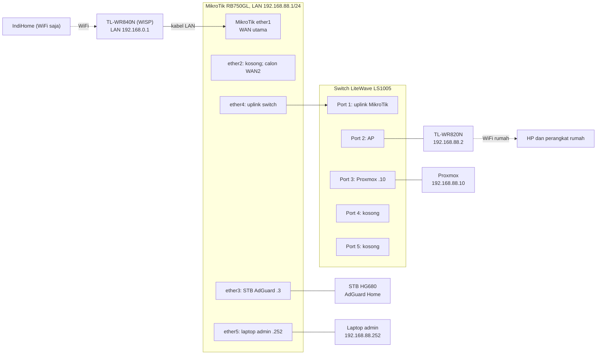
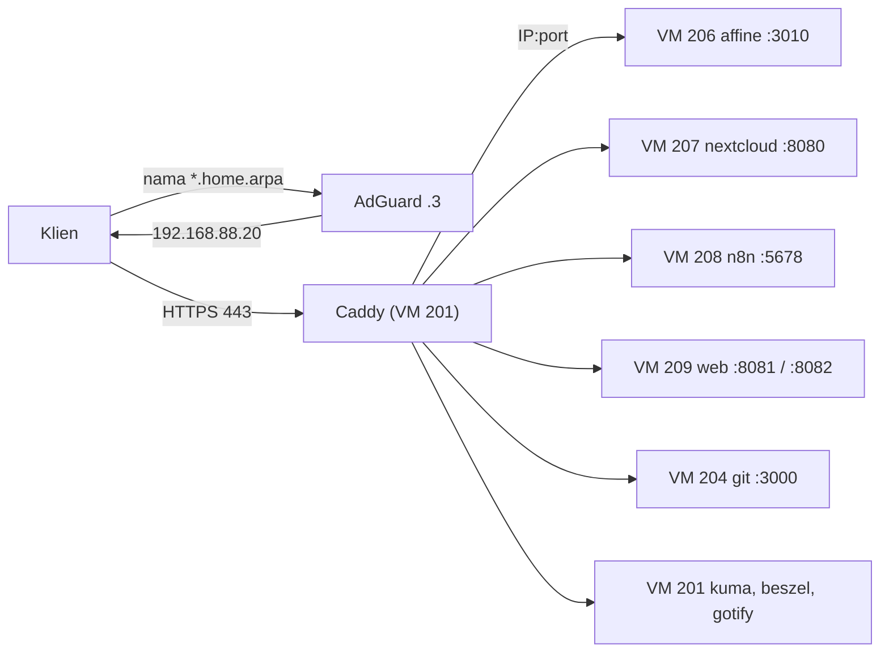
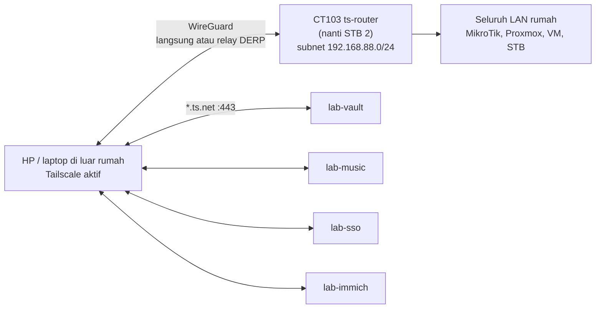
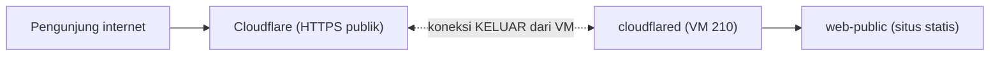
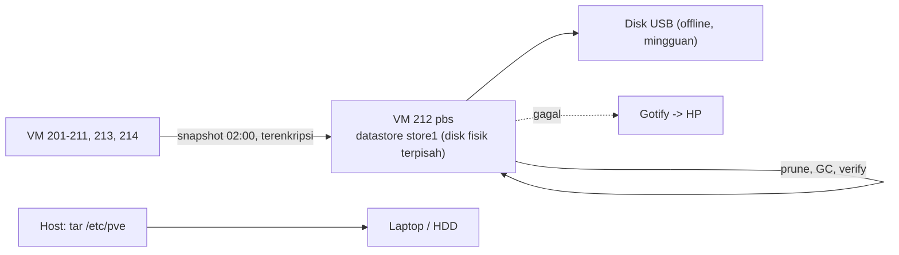
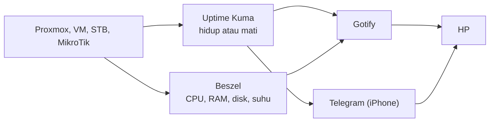
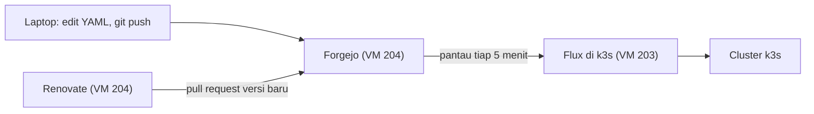

# 02 - Rangkaian koneksi

> Audit terkini 6 Nov 2026: inventaris live, guest, alamat, port, keterhubungan, dan ketidakpastian RouterOS ada di [docs/16](16-inventaris-live-2026-11-06.md). Diagram kabel/rencana di dokumen ini sebagian besar catatan historis dan belum diverifikasi ulang. Jangan menganggap proxy Caddy, VM 201–211, port forwarding, DNS DHCP, atau firewall di bawah sudah diterapkan.

Dari kabel fisik sampai alur data. Diagram memakai Mermaid (tampil otomatis di GitHub).

## 1. Rangkaian fisik (kabel dan radio)



Catatan kabel:
- Susunan kabel yang dilaporkan pengguna per 1 Nov 2026: ether1 WAN dari WR840N, ether2 kosong (rencana WAN2), ether3 STB AdGuard, ether4 switch, ether5 laptop admin. Switch port 1 menerima uplink dari ether4; port 2 ke AP; port 3 ke Proxmox; port 4-5 kosong.
- Rencana masa depan: ether2 akan dipakai untuk modem WAN cadangan saat IndiHome mati. Sebelum itu, rancang dan uji failover WAN; Proxmox saat ini sudah berada di switch port 3.
- Proxmox saat ini tersambung ke switch port 3; switch port 1 ke MikroTik ether4. MikroTik ether2 kosong; STB ke ether3.

## 2. Rangkaian logis (alamat)

| Lapisan | Alamat | Fungsi |
|---|---|---|
| Jaringan atas | `192.168.0.0/24` | LAN TL-WR840N; MikroTik ether1 = .100 |
| LAN rumah | `192.168.88.0/24` | MikroTik .1 (gateway, DHCP, NAT) |
| Pool DHCP | `.100 - .254` | Klien biasa |
| AdGuard STB 1 | `.3` | Static DHCP lease; sebelumnya `.253` |
| Server (di luar pool) | `.2 - .99` | Static lease / IP statis |
| Tailnet | `100.x.y.z` | Tailscale |

NAT berlapis: perangkat -> MikroTik (masquerade di ether1) -> TL-WR840N (WISP) -> IndiHome.

## 3. Alur DNS (nama menjadi alamat)

```mermaid
sequenceDiagram
  participant K as Klien (HP/laptop)
  participant M as MikroTik DHCP
  participant A as AdGuard STB 1 (.3)
  participant B as AdGuard CT101 (.11)
  participant U as Upstream (Quad9 / 1.1.1.1)
  K->>M: minta IP (DHCP)
  M-->>K: IP + DNS .3; .11 hanya setelah layanan cadangan diuji
  K->>A: kuma.home.arpa ?
  A-->>K: 192.168.88.20 (DNS rewrite *.home.arpa)
  K->>A: google.com ?
  A->>U: teruskan
  U-->>A: jawaban
  A-->>K: jawaban
  K->>A: doubleclick.net ?
  A-->>K: 0.0.0.0 (diblokir)
  Note over K,B: .11 belum aktif/terverifikasi; jangan dibagikan sebagai DNS cadangan dulu
```

Aturan: jangan menaruh DNS publik (8.8.8.8) sebagai DNS kedua di DHCP; sebagian klien lolos dari pemblokiran.

## 4. Alur akses layanan privat



Firewall Proxmox: VM tujuan hanya menerima port itu dari `192.168.88.20`.

## 5. Alur akses jarak jauh (Tailscale)



- Tidak ada port yang dibuka di router.
- `tailscale funnel` **tidak pernah** dijalankan.
- Node `lab-*` menjalankan Tailscale Serve di VM sendiri (port 443), meneruskan ke `127.0.0.1:PORT`.

## 6. Alur publik opsional (Cloudflare Tunnel)



VM 210 tidak boleh menjangkau LAN (firewall `OUT DROP 192.168.88.0/24`, kecuali DNS).

## 7. Alur backup



## 8. Alur peringatan dan monitoring



Batas: bila IndiHome atau listrik rumah mati, tidak ada notifikasi yang sampai (butuh layanan luar seperti Healthchecks.io).

## 9. Alur Wake-on-LAN

STB 1 (`.3`) menjalankan `nyalakan-proxmox` (magic packet ke MAC Proxmox). Dari luar rumah:
HP -> Tailscale -> SSH ke STB -> perintah WoL. Wajib di BIOS: Wake on LAN aktif, ErP/Deep Sleep mati,
Restore on AC Power Loss = Power On.

## 10. Alur GitOps (Flux, Renovate)


