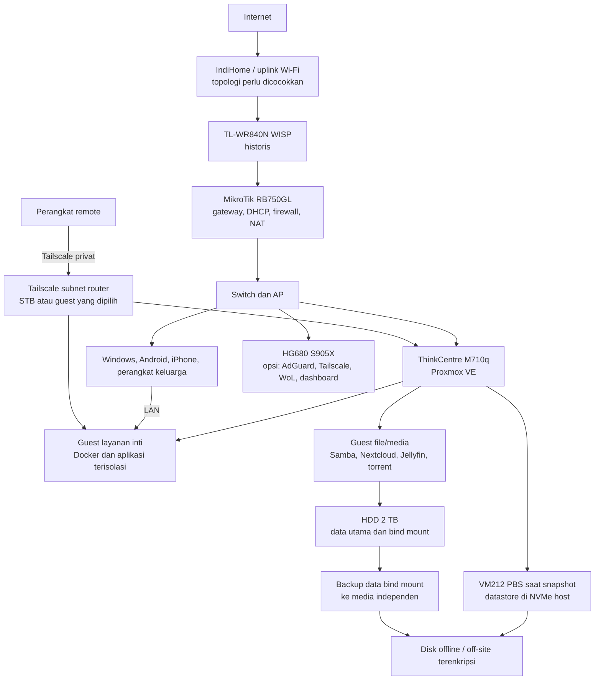

# Perencanaan menyeluruh Home Server Lab

**Catatan sesi:** 7 November 2026
**Basis kondisi:** snapshot audit yang dilaporkan bertanggal 6 November 2026 dan keterangan pengguna pada sesi perencanaan.
**Status:** rancangan saja; tidak ada audit live, perubahan server/router, instalasi, reset, atau perubahan konfigurasi repo layanan yang dilakukan untuk menyusun rencana ini.

> Alamat IP, port, status guest, dan konfigurasi dapat berubah. Saat tahap pelaksanaan diminta, mulai dengan audit baca-saja. Jangan menafsirkan guest `stopped` sebagai belum dibuat atau kosong. Verifikasi konflik DHCP dan ID Proxmox sebelum membuat alokasi.

## 1. Cara membaca catatan

- **[LIVE-6-NOV]**: dilaporkan terlihat saat audit 6 November 2026; bukan kondisi live sekarang.
- **[LAPORAN]**: informasi yang disampaikan pengguna, belum tentu dicocokkan dengan perangkat.
- **[TARGET LAMA]**: pernah direncanakan; bukan keputusan final atau bukti layanan sudah ada.
- **[BELUM DIVERIFIKASI]**: perlu audit atau keputusan sebelum pelaksanaan.

Dokumen ini melengkapi [inventaris live 6 November](../docs/16-inventaris-live-2026-11-06.md), tidak menggantikannya. Catatan lama repo dapat berisi snapshot yang lebih tua dan berbeda.

## 2. Ringkasan risiko dan konflik

1. **PBS satu host:** [LIVE-6-NOV] VM212 berjalan di NVMe fisik yang sama dengan Proxmox. Ini membantu pemulihan guest tertentu, tetapi bukan salinan independen dari kegagalan NVMe/host.
2. **Bind mount tidak tercakup:** [LIVE-6-NOV] bind mount HDD dengan `backup=0` tidak masuk backup guest. Backup CT104 yang disebut mengecualikan `/srv/media` dan `/srv/appdata`. Foto/video dan data aplikasi perlu salinan terpisah serta uji restore.
3. **Thin-pool:** pernah muncul peringatan autoextend/overcommit. Kapasitas dan konfigurasi perlu diperiksa sebelum menambah guest atau data.
4. **CT104 adalah layanan sekaligus rollback:** berisi Immich, Beszel, exporter, Portainer lama dan komponen lama Nextcloud. Jangan menghentikan atau menghapus sebelum dependensi, data, dan jalur rollback dipastikan.
5. **Guest stopped tetap ada:** CT113/114/116/117/118/120/122/123 serta sejumlah VM pernah dibuat dan berhenti. Inventaris data/config sebelum mengaktifkan, mengubah, atau menghapus.
6. **Konflik Navidrome:** CT121 dilaporkan sebagai Speedtest Tracker; target lama Navidrome CT121/VM211 tidak berlaku otomatis. CT123 pernah dibuat untuk Navidrome. Putuskan dari hasil audit.
7. **VM202:** Home Assistant OS dilaporkan stopped pada snapshot terakhir, padahal sebelumnya aktif. Isi disk, status, dan kebutuhan pemulihan harus dicocokkan.
8. **STB sebagai titik kegagalan tunggal:** jika STB menanggung DNS, Tailscale/subnet route, dashboard, dan WoL, kegagalannya dapat memutus beberapa jalur sekaligus.
9. **Alamat dan ID bukan reservasi:** DHCP pool/lease/router aktual belum diperiksa pada audit terakhir yang disampaikan. `nextid=124` adalah petunjuk historis, bukan jaminan ID aman.
10. **Reset perangkat belum direncanakan untuk dijalankan:** reset HG680 dapat menghapus OS/konfigurasi/data STB. Reset ThinkCentre dapat menghapus host, guest, dan data lokal. “Old PC” belum jelas perangkat yang dimaksud.

## 3. Arsitektur target yang disarankan



### Prinsip penempatan

- Proxmox menjadi hypervisor; layanan diletakkan di VM/LXC sesuai fungsi, resource, dan batas isolasinya.
- STB baru dipilih sebagai layanan kontrol setelah board/revisi, OS, boot/recovery, storage, RAM, dan jalur pemulihan dibuktikan. Sediakan akses admin LAN yang tetap berfungsi saat STB mati.
- Satu dashboard depan saja: pilih Homepage atau Homeio setelah evaluasi. Portainer mengelola Docker; Prometheus/Grafana, Uptime Kuma, dan Beszel adalah monitoring, bukan pengganti dashboard atau backup.
- Satu jalur tulis utama untuk setiap pohon data. Jellyfin bersifat read-only pada media; qBittorrent hanya intake/staging; n8n hak akses minimum; tidak ada otomasi yang menulis ke Immich.
- Akses jarak jauh administrasi melalui Tailscale privat. Jangan expose PVE, PBS, Portainer, SSH, SMB, database, atau UI torrent ke internet.

## 4. Matriks guest yang tercatat

Semua status dan alamat berikut **[LIVE-6-NOV] menurut snapshot yang disampaikan**, bukan hasil pemeriksaan sesi ini. IP DHCP bukan bukti reservation/static.

| Guest | Catatan status/fungsi snapshot | Rekonsiliasi yang diperlukan |
|---|---|---|
| CT100 | Template Debian 13, stopped | Template; pastikan tidak ada perubahan lokal penting. |
| CT101 | AdGuard kedua, `.11` | Cocokkan dengan AdGuard STB dan strategi DNS cadangan. |
| CT102 | Samba, `.12` | Audit share, mount, izin, dan penulis utama. |
| CT103 | Tailscale subnet router, DHCP `.104` | Bandingkan dengan rencana STB; pertahankan fallback sebelum migrasi. |
| CT104 | Immich stack, Beszel hub, exporter, Portainer lama, MariaDB/Redis Nextcloud lama, `.20` | Aktif dan punya peran rollback; audit mount dan dependensi. |
| CT105 | Portainer Server, DHCP `.105`, UI 9443 | Verifikasi IP/akses; backup konfigurasi dan semua environment. |
| CT106 | Jellyfin, DHCP `.111`, port 8096 | Media dilaporkan read-only; pertahankan batas ini. |
| CT107 | Nextcloud, DHCP `.112`, port 8080 | Backup DB, data mount, dan konfigurasi konsisten. |
| CT108 | qBittorrent, DHCP `.114`, WebUI 8080, torrent 6881 TCP/UDP | Batasi ke LAN/tailnet; hanya Inbox/staging. |
| CT109–112 | Kuma `.106:3001`, Prometheus `.107:9090`, Grafana `.108:3000`, Gotify `.109:8070` | Konfirmasi exporter, notifikasi, dan akses. |
| CT113–114 | Beszel hub dan Caddy/CA lokal pernah dibuat, stopped | Guest sudah pernah dibuat; bukan ID kosong. |
| CT115 | Homepage `.110:3000` | Kandidat dashboard; bandingkan dengan Homeio. |
| CT116–118 | Forgejo, Renovate, AFFiNE pernah dibuat, stopped | Periksa isi guest dan prasyarat; semuanya opsi sampai diputuskan. |
| CT119 | n8n, PostgreSQL, helper media, DHCP `.113`, port 5678 | Audit akses tulis Jellyfin dan minimalkan izin. |
| CT120 | WordPress pernah dibuat, stopped | Opsional; evaluasi isolasi sebelum publikasi. |
| CT121 | Speedtest Tracker `.115:8765`, 512 MiB, Agent Portainer | DHCP dinamis, `onboot` tidak tercatat, Agent `latest` dilaporkan terbuka pada semua interface; konflik Navidrome lama. |
| CT122–123 | OnlyOffice dan Navidrome pernah dibuat, stopped | Audit data dan konfigurasi sebelum keputusan. |
| VM200–201 | Template Debian dan Docker-core legacy, stopped | Inventaris disk dan fungsi sebelum digunakan ulang. |
| VM202 | Home Assistant OS, stopped pada audit terakhir | Sebelumnya aktif; cocokkan disk dan kebutuhan. |
| VM203, 205, 210 | k3s/Flux, Vaultwarden, situs statis pernah dibuat, stopped | Target lama/opsional; audit data dan isolasi. |
| VM212 | PBS berjalan; datastore di NVMe yang sama | Tambahkan backup independen; uji pemulihan. |
| VM213 | Pocket ID pernah dibuat, stopped | Opsi; pertimbangkan dampak SSO pada pemulihan. |
| CT124 | Usulan guest Immich khusus | Keberadaan dan ketersediaan ID belum diketahui. |

## 5. Layanan dan hubungan data

| Layanan | Penempatan kandidat | Dependensi/resource | Akses dan port historis | Backup/pemulihan |
|---|---|---|---|---|
| AdGuard Home | STB atau CT101 | DNS LAN; rendah | DNS LAN; port aktual diaudit | Ekspor konfigurasi, dokumentasikan upstream/filter, uji resolver cadangan. |
| Tailscale | STB atau CT103 | IP forwarding untuk subnet routing; rendah | Tailnet privat | Simpan prosedur/ACL tanpa secret; uji jalur admin alternatif. |
| Homeio | OS Linux kompatibel di guest atau STB setelah validasi | Docker; rendah–sedang | Installer langsung port 80; Compose 12026 menurut dokumentasi | Database, konfigurasi, data app ke media lain; uji restore. |
| Portainer | CT105 kandidat Server; Agent pada Docker guest | Linux + Docker; rendah | CT105 UI 9443 historis; Agent default 9001 | Backup data/config dan stack; port Agent hanya dari Server. |
| Homepage | CT115 historis | Ringan | 3000 historis | Backup konfigurasi atau rebuild dari sumber tersimpan. |
| Samba | CT102 historis | HDD dan ACL; rendah–sedang | SMB LAN/tailnet | Data file + ACL/share config; uji restore izin. |
| Immich | CT104 saat ini dalam snapshot; guest khusus usulan | PostgreSQL/vector DB, Valkey, media, ML; sedang–tinggi | 2283 tercatat dalam inventaris live | Database dan seluruh media harus dipulihkan berpasangan; bind mount dicadangkan terpisah. |
| Nextcloud | CT107 historis | MariaDB, Redis, data mount; sedang | 8080 historis | Database, data, config, versi aplikasi yang cocok; uji konsistensi restore. |
| Jellyfin | CT106 historis | Media, transcoding; sedang/variabel | 8096 historis | Metadata/config; media disalin terpisah. |
| qBittorrent | CT108 historis | Inbox/staging; variabel | WebUI 8080, TCP/UDP 6881 historis | Config/state yang dibutuhkan; data torrent ditangani sebagai data terpisah. |
| n8n + PostgreSQL | CT119 historis | DB, helper, staging dan folder tujuan; sedang | 5678 historis; privat | DB/workflow/config terenkripsi sesuai kebutuhan; uji pemulihan workflow. |
| Local AI runtime (Ollama) | Guest Linux khusus setelah audit | Model lokal memakai CPU/RAM; kandidat awal Qwen 3.5 4B quantized; performa CPU harus diuji dan dapat memperlambat guest lain | API 11434 hanya LAN/tailnet terpilih; antarmuka browser dapat memakai Open WebUI | Model dapat diunduh ulang; backup data/config UI dan catat versi model/runtime. |
| 9Router | CT Linux khusus setelah audit | Gateway/router API, bukan runtime model; beban diperkirakan ringan tetapi kebutuhan resmi spesifik belum ditemukan | Dashboard/API 20128 menurut repo upstream; LAN/tailnet saja; jangan expose internet | Backup SQLite/config/data directory dan prosedur pemulihan rahasia provider tanpa menyimpan secret di repo. |
| PBS | VM212 historis | Backup guest; sedang | UI 8007 menurut dokumentasi PBS | Datastore independen dari host; kunci pemulihan aman; uji restore berkala. |
| Monitoring | CT104, CT109–112, CT113 historis | Exporter, storage metrik, notifikasi | Kuma 3001, Prometheus 9090, Grafana 3000, Gotify 8070 historis | Backup config/data penting; definisi dashboard disimpan. |
| AFFiNE, Forgejo, Renovate, Vaultwarden, Pocket ID, WordPress, OnlyOffice, Navidrome, k3s, situs publik | Guest stopped/target lama | Resource dan kebutuhan belum diputuskan | Port dan cakupan akses belum ditetapkan | Wajib punya prosedur backup dan uji restore sebelum adopsi. |

Port di tabel adalah catatan historis, bukan aturan firewall aktual.

### Alur data media dan file

```text
Manual / torrent / unduhan langsung
               │
               ▼
       Inbox dan staging HDD
               │
               ▼
      n8n klasifikasi dan validasi
         ├── ambigu → Review + persetujuan
         └── pasti → tujuan Jellyfin → Jellyfin scan (read-only)

Samba → akses manusia sesuai share dan ACL
Nextcloud → data directory terpisah; jalur tulis utama ditetapkan
Immich → database + media Immich; tidak dapat ditulis qBittorrent/n8n
Bind mount → backup data terpisah → salinan independen/offline/off-site
Guest → backup PBS (tidak otomatis mencakup bind mount yang dikecualikan)
```

Perlindungan otomasi yang direncanakan: mitigasi SSRF pada URL, batas ukuran/jenis file, validasi path, menunggu file stabil, cegah overwrite, audit log, dan review manusia untuk klasifikasi yang tidak yakin.

## 6. Rencana firewall dan akses

Target kebijakan, bukan konfigurasi live:

| Sumber | Tujuan | Kebijakan target |
|---|---|---|
| Perangkat admin LAN | PVE, PBS, SSH, Portainer, monitoring | Izinkan hanya perangkat/admin yang dipilih; inventaris saat audit. |
| LAN keluarga | DNS, Samba, Nextcloud, Immich, Jellyfin | Izinkan port layanan yang dibutuhkan; jangan beri akses panel manajemen secara otomatis. |
| Tailnet | Layanan privat dan admin yang dipilih | Akses minimum per perangkat/pengguna; uji jalur saat STB/subnet router mati. |
| Portainer Server | Agent di guest Docker | Port 9001 hanya dari Server, tidak semua interface/LAN. |
| Antar guest | DB/cache/storage | Hanya koneksi dependensi yang diperlukan. |
| Internet masuk | Router/guest | Tidak ada port-forward untuk PVE/PBS/Portainer/SSH/SMB/database/torrent UI. Publikasi web adalah keputusan terpisah dengan isolasi. |

Dokumentasi Tailscale menyatakan fitur subnet router memerlukan IP forwarding; route dan kontrol akses adalah mekanisme terpisah, dan route terpasang tidak menjamin konektivitas jika perangkat offline atau policy menolak trafik. Lihat [IP forwarding](https://tailscale.com/docs/reference/troubleshooting/network-configuration/ip-forwarding-errors-advertise) dan [route injection](https://tailscale.com/docs/reference/route-injection).

## 7. Pusat manajemen dan dashboard

- **PVE:** pengelolaan host, VM/LXC, storage, task.
- **Portainer:** pengelolaan Docker pada guest Linux. Server di guest khusus lebih mudah dibackup/dipulihkan terpisah dari reset STB. Jangan migrasikan sebelum konfigurasi/environment diuji.
- **Homeio:** dashboard dan pengelolaan Docker/file. Menurut dokumentasi resmi, installer langsung mendukung Debian/Ubuntu/Raspberry Pi OS di x86_64 atau ARM 64-bit; Compose berjalan pada sistem dengan Docker. Skrip menyiapkan Docker jika perlu, service, PostgreSQL, dan Nginx. Homeio bukan OS, memiliki satu akun per instalasi dan fungsi terminal; dokumen resmi juga menyebut telemetry anonim yang dapat dimatikan. Verifikasi dukungan board HG680 secara terpisah; ARM64 umum tidak membuktikan dukungan board. [Install](https://homeio.app/install), [docs](https://homeio.app/docs).
- **Homepage:** indeks tautan ringan yang tercatat di CT115. Dapat ditautkan dari Homeio; pilih satu halaman depan agar tidak memelihara dua dashboard dengan fungsi tumpang tindih.
- **Monitoring:** Uptime Kuma untuk pemeriksaan layanan; Prometheus/Grafana untuk metrik; Beszel sebagai opsi ringkas; Gotify untuk notifikasi. Pastikan Prometheus memakai exporter yang benar sebelum menghentikan exporter CT104.
- **Portainer Agent:** dokumentasi Portainer menyebut port default 9001 dan kebutuhan konektivitas dari Server; batasi firewall sesuai sumber tersebut. [Dokumentasi Agent](https://docs.portainer.io/admin/environments/add/docker/agent).

### Kandidat local AI dan 9Router

- **Ollama menjalankan model lokal.** Pada M710q tanpa GPU, jadikan Qwen 3.5 4B versi Q4 sebagai titik awal uji; file model tercatat sekitar 3,3 GB. Model 9B sekitar 6,6 GB dan akan menambah beban RAM/CPU. Ukuran file bukan seluruh kebutuhan RAM: konteks dan guest lain ikut memakai memori. Jangan menganggap model 256K context praktis pada host ini; mulai dengan konteks pendek dan ukur penggunaan resource.
- **9Router adalah gateway API, bukan AI/model lokal.** Ia dapat menjadi endpoint bersama untuk aplikasi klien dan merutekan permintaan ke provider yang dikonfigurasi. Jika provider itu cloud, prompt keluar ke provider tersebut. Dokumentasi upstream mencatat Docker image untuk `linux/amd64` dan data aplikasi di SQLite pada data directory; port contoh dashboard/API adalah 20128. Kebutuhan CPU/RAM resmi spesifik belum ditemukan, jadi alokasikan konservatif lalu ukur.
- **Integrasi 9Router ↔ Ollama untuk chat belum dipastikan.** Dokumentasi 9Router menyebut endpoint self-hosted secara jelas untuk STT/TTS/embedding dan juga membahas custom endpoint kompatibel OpenAI/Anthropic; belum ditemukan resep upstream eksplisit untuk chat Ollama. Rencana awal: uji integrasi hanya setelah audit, atau pakai Ollama + Open WebUI langsung untuk chat lokal.
- **Penempatan:** gunakan guest Linux khusus setelah daftar guest/ID/IP diaudit. Jangan pasang Docker di host Proxmox. Pisahkan Ollama dan 9Router secara logis; jika resource terbatas, mulai dengan satu model kecil, satu pengguna, dan hentikan percobaan sebelum menambah layanan lain. Empat core fisik harus dibagi dengan guest yang sudah berjalan.
- **Keamanan:** batasi port 20128 dan Ollama 11434 ke LAN admin/tailnet yang dipilih; tidak ada port-forward internet. Upstream 9Router menampilkan variabel `INITIAL_PASSWORD`, `JWT_SECRET`, `REQUIRE_API_KEY`, dan menyimpan data provider/config di data directory; ganti nilai awal, aktifkan autentikasi endpoint yang sesuai, backup direktori tersebut, dan jangan simpan credential/token di repo.
- **UI laptop:** Open WebUI dapat menjadi antarmuka browser yang berbicara langsung dengan Ollama. Ini menambah satu aplikasi/data store yang juga perlu backup dan kontrol akses. [Panduan Open WebUI + Ollama](https://docs.openwebui.com/getting-started/quick-start/connect-a-provider/).

Rujukan resmi diperiksa untuk catatan ini: [katalog Qwen 3.5 di Ollama](https://ollama.com/library/qwen3.5), [cara Ollama membuka API jaringan](https://github.com/ollama/ollama/blob/main/docs/faq.mdx), [repo 9Router dan deployment](https://github.com/decolua/9router), [fitur dan provider 9Router](https://9router.com/). Rujukan mendeskripsikan kemampuan upstream, bukan verifikasi terhadap host/guest lokal.

## 8. Storage dan backup 3-2-1

1. **Data utama:** HDD Seagate 2 TB ext4 yang dilaporkan pernah aktif sebagai `/mnt/pve/backup-disk`; cocokkan mount dan fungsi aktual. Data utama bukan backup.
2. **Salinan kedua:** backup guest PBS ditambah backup terpisah untuk bind mount media, Nextcloud, appdata, dan share penting ke disk/perangkat independen.
3. **Salinan ketiga:** disk offline bergilir atau tujuan off-site terenkripsi, dipilih berdasarkan biaya, privasi, dan kecepatan pemulihan.

Rencana juga perlu: enkripsi, retensi harian/mingguan/bulanan yang muat, salinan kunci pemulihan terpisah dari server, inventaris apa yang dikecualikan, dokumentasi urutan restore, serta uji pemulihan file/database/guest. Jangan mencatat password, token, private key, kunci enkripsi, isi `.env`, atau data sensitif dalam repo.

Dokumentasi PBS menyarankan server backup terpisah untuk mengurangi ketergantungan pada hypervisor dan host yang sama. [PBS installation](https://pbs.proxmox.com/docs/installation.html).

## 9. Fase pelaksanaan kelak

Tidak satu pun fase berikut dimulai tanpa permintaan pelaksanaan terpisah.

| Fase | Prasyarat/risiko | Perangkat terdampak dan langkah tingkat tinggi | Backup/rollback | Kriteria lulus |
|---|---|---|---|---|
| 1. Fondasi dan audit | Snapshot lama; stopped bukan kosong | Baca-saja: PVE, semua guest, storage, router, DHCP, firewall, port, dependensi dan backup | Tidak mengubah; simpan hasil audit tanpa rahasia | Inventaris bertanggal dan konflik ID/IP teridentifikasi. |
| 2. Storage/backup | Thin-pool; PBS satu NVMe; bind mount dikecualikan | Audit kapasitas/health; desain salinan bind mount dan target independen | Uji restore guest, DB, file, konfigurasi | Sampel pulih ke lokasi yang disepakati. |
| 3. Jaringan/STB | Pool/lease dan board HG680 belum diverifikasi; STB titik tunggal | Audit router; validasi image/boot/recovery; putuskan DNS, Tailscale, WoL, dashboard | Backup konfigurasi/data STB dan jalur admin lokal | DNS, admin LAN, dan akses darurat tetap ada saat STB dimatikan. |
| 4. Layanan inti | Jalur tulis dan data HHD perlu dipastikan | Tetapkan Samba/Nextcloud/Immich/Jellyfin/torrent; cek izin dan mount | Backup konsisten sebelum migrasi; guest sumber dipertahankan | Klien keluarga dapat akses sesuai izin; data uji pulih. |
| 5. Migrasi/konsolidasi | CT104 rollback dan exporter harus tetap tersedia | Satu layanan per migrasi; validasi sebelum pensiun sumber | Rollback ke guest/data lama | Aplikasi, data, monitoring dan backup lulus validasi. |
| 6. Otomasi | SSRF, salah klasifikasi, overwrite, izin luas | Batasi qBittorrent/n8n; validasi, Review, log, persetujuan | Karantina/salinan dan pemulihan workflow | Berkas uji tidak overwrite; ambigu tertahan. |
| 7. Monitoring/akses | Duplikasi dashboard/exporter; remote access | Pilih dashboard, alarm, policy Tailscale dan akses admin | Backup konfigurasi/definisi dashboard | Alarm uji diterima; akses sesuai LAN/tailnet. |
| 8. Opsional/local AI | CPU 4 core/4 thread dan RAM terbatas; guest layanan aktif berbagi resource | Setelah audit, pilot Ollama 4B dan/atau 9Router sebagai gateway; uji koneksi, auth, latensi, resource, dan jalur data prompt | Backup guest/data directory; rollback dengan menghentikan guest dan memulihkan config | Laptop dapat mengakses dari LAN/tailnet terpilih, tidak dari internet; resource host stabil; provider dan lokasi data prompt dipahami. |

Untuk setiap fase, isi tabel berikut **setelah audit**; jangan mengarang alamat atau port.

| Perangkat/guest | MAC | DHCP reservation/static | IP aktual | Port aktual | URL LAN | URL tailnet | Catatan/konflik |
|---|---|---|---|---|---|---|---|
| MikroTik/router | Belum diisi | Belum diisi | Belum diisi | Audit | — | — | Pool, lease, NAT, firewall |
| Proxmox host | Belum diisi | Belum diisi | Belum diisi | Audit | Belum diisi | Belum diisi | ID/IP tidak diasumsikan |
| STB HG680 | Belum diisi | Belum diisi | Belum diisi | Audit | Belum diisi | Belum diisi | Model/revisi, recovery |
| Guest yang ada | Dari audit | Verifikasi konflik | Dari audit | Dari audit | Dari audit | Dari audit | Termasuk guest stopped |
| Guest target | Belum ditetapkan | Cek pool dahulu | Belum ditetapkan | Rencana | Belum ditetapkan | Belum ditetapkan | Cek ID dan IP sebelum dibuat |

## 10. Keputusan yang masih terbuka

Jawab berurutan, satu per satu:

1. **Perangkat mana yang Anda maksud dengan “reset old PC”: HG680, ThinkCentre/Proxmox, atau PC lain?** Jawaban ini menentukan risiko penghapusan dan jalur recovery.
2. Setelah itu: apakah Homeio ingin dievaluasi sebagai dashboard utama, atau cukup Homepage sebagai halaman tautan?
3. Kemudian tentukan perangkat mana yang akan menjadi resolver DNS cadangan jika STB mati.
4. Tentukan target backup independen yang realistis: disk eksternal offline, NAS/perangkat lain, off-site, atau kombinasi.
5. Putuskan daftar layanan opsional yang benar-benar dibutuhkan setelah guest stopped dan datanya diaudit.
6. Putuskan apakah kebutuhan Anda adalah (a) chat lokal dengan Ollama, (b) gateway 9Router untuk provider cloud, atau keduanya; integrasi 9Router sebagai backend chat Ollama perlu diuji dahulu.

## 11. Batas tahap ini

- Tidak ada login server, perintah server/router, perubahan Proxmox, DHCP, guest, Portainer, instalasi, backup, atau reset.
- Tidak ada target IP, VMID, static route, atau alamat layanan baru yang ditetapkan.
- Setelah rancangan disepakati, perubahan implementasi hanya dilakukan atas instruksi terpisah dan diawali audit baca-saja. Dokumentasi ini sendiri adalah catatan perencanaan dan tidak mengklaim layanan/backup telah diuji.
